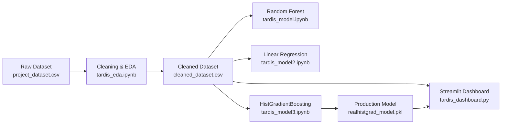

# TARDIS — SNCF Train Delay Analysis & Prediction

TARDIS is a data science and machine learning project focused on analyzing French railway (**SNCF**) journey records, identifying seasonal and route-level delay patterns, and predicting expected arrival delays (in minutes) via an interactive **Streamlit** dashboard.

---

## Key Features

- **Data Cleaning & Preprocessing (`tardis_eda.ipynb`):**
  - Deduplication, data type normalization, missing-value imputation, and temporal feature extraction (`month` from journey dates) on `project_dataset.csv` to produce `cleaned_dataset.csv`.
- **Exploratory Data Analysis (`tardis_eda.ipynb`):**
  - Statistical distributions of train arrival delays, station-by-station delay comparisons, seasonal/monthly heatmaps, and peak delay identification.
- **Multi-Model Benchmarking (`tardis_model*.ipynb`):**
  - **`tardis_model.ipynb`:** Baseline and tuned `RandomForestRegressor` experiments.
  - **`tardis_model2.ipynb`:** `LinearRegression` modeling and investigation of target/feature leakage.
  - **`tardis_model3.ipynb`:** Production `HistGradientBoostingRegressor` pipeline trained strictly on pre-departure features (without data leakage), exported to `realhistgrad_model.pkl`.
- **Interactive Streamlit Dashboard (`tardis_dashboard.py`):**
  - Route explorer (`Departure Station → Arrival Station`) displaying historical average arrival delays.
  - Dataset KPIs (total records, mean delay, median delay), delay distribution histogram with KDE, and monthly average delay heatmap.
  - Real-time delay predictor powered by `realhistgrad_model.pkl`.

---

## Workflow Architecture



---

## Project Structure

```text
tardis/
├── project_dataset.csv       # Raw SNCF train delay dataset
├── cleaned_dataset.csv       # Cleaned dataset used by models and dashboard
├── tardis_eda.ipynb          # Data cleaning, preprocessing, and exploratory visualizations
├── tardis_model.ipynb        # RandomForestRegressor experiments
├── tardis_model2.ipynb       # LinearRegression & data leakage analysis
├── tardis_model3.ipynb       # HistGradientBoostingRegressor training & evaluation
├── realhistgrad_model.pkl    # Serialized production model & feature columns for the dashboard
├── tardis_dashboard.py       # Interactive Streamlit visualization & prediction app
├── requirements.txt          # Python dependencies
└── README.md
```

---

## Installation & Setup

1. **Clone the repository:**

```bash
git clone https://github.com/AlexandrG1209/tardis.git
cd tardis
```

2. **Create a virtual environment and install dependencies:**

```bash
python3 -m venv .venv
source .venv/bin/activate
pip install -r requirements.txt
```

---

## Usage

### 1. Run the Interactive Dashboard

```bash
streamlit run tardis_dashboard.py
```

In the dashboard you can:
- Filter any `Departure → Arrival` station route to inspect historical delay metrics.
- Explore the arrival delay distribution and monthly seasonality heatmap.
- Predict the expected arrival delay (in minutes) for a journey by specifying:
  - **Month** (`1`–`12`)
  - **Average journey duration** (`Durée moyenne du trajet`)
  - **Number of planned circulations** (`Nombre de circulations prévues`)
  - **Service type** (`National`, `International`, `Unknown`)
  - **Departure station** (`Gare de départ`) & **Arrival station** (`Gare d'arrivée`)

### 2. Run the Jupyter Notebooks

```bash
jupyter notebook
```

---

## Model Evaluation Metrics

Models are evaluated in the notebooks using:
- **$R^2$ Score** (Coefficient of determination)
- **MAE** (Mean Absolute Error in minutes)
- **Cross-Validation** across train/test splits

---

## Tech Stack

- **Language:** Python 3
- **Data Manipulation:** `pandas`, `numpy`
- **Machine Learning:** `scikit-learn`, `joblib`
- **Visualization & Web App:** `streamlit`, `matplotlib`, `seaborn`

---

## Contributors

- **Alexandr Gorlachev** — [@AlexandrG1209](https://github.com/AlexandrG1209)
- **Mattis Philippe** — [@Mattis-Philippe](https://github.com/Mattis-Philippe)
